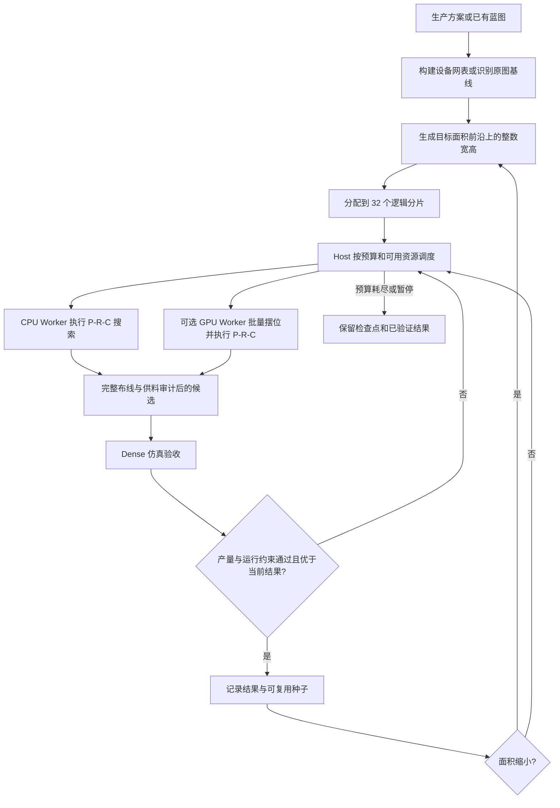
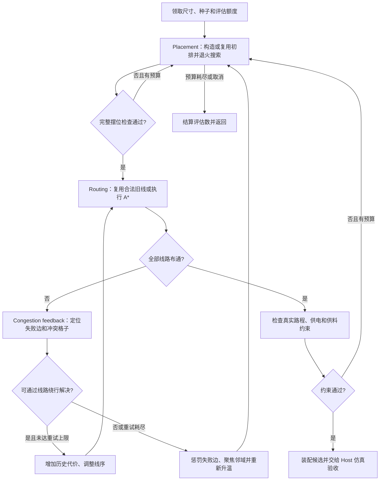

# EDA 算法简述

[返回 README](../../README.md#计算蓝图)

IndustrialPlanner 的 EDA 将生产方案转换为可摆放、可连接、可运行的蓝图，也支持以已有蓝图为基线继续优化。它采用多尺寸分片搜索：每个 Worker 在指定矩形内执行 Placement（摆位）、Routing（布线）和 Congestion feedback（拥塞反馈）的迭代闭环，候选通过真实仿真后才成为可交付结果。

本文按 2026-10-10 的当前实现说明算法。搜索采用启发式方法，目标是在给定计算预算内找到更好的可行布局，不保证全局最优。

## 1. 总体流程与优化目标

产线生成入口读取生产方案、物料流量和供给／输出要求，构建设备与连接网表，准备物流控制、环境设施和启动供料。原图优化入口先识别已有蓝图的运行基线，再在允许的设备、配置与减量范围内搜索。两种入口共用紧凑摆位搜索器和 Router，准备过程及约束有所不同。

搜索评分与交付排名承担不同职责：

- **搜索评分**引导移动设备，综合估计线路长度、拥塞、越界、几何冲突、端口连通性等成本；允许探索暂时较差的状态。
- **交付排名**只比较通过验收的候选，优先缩小完整矩形面积。产线生成在同面积下优先减少输出箱，再比较物流长度、转弯和额外设施等施工成本；原图优化不使用输出箱数量作为额外排名偏好。

宽、高分别受 70 格上限约束。声明尺寸、设备、物流和验收夹具必须一致，不能只看面积数字就认为布局合法。

## 2. 分片与 Worker 调度

### 尺寸如何分片

**32 个分片是逻辑搜索单元，与 Worker 数量独立。** 调整并发改变执行速度与搜索交错顺序，不重新划分尺寸归属。

设目标面积为 `A`，调度器对每个允许的整数宽度 `w` 取 `h = min(70, floor((A - 1) / w))`，并过滤不满足最小边长的组合。这样覆盖不同长宽比的面积前沿，而不是穷举所有更小矩形。宽高互换仍分别保留，因为边界设施和端口朝向可能使两个方向具有不同的可行性。

每个尺寸的分组权重为 `min(1, 2 × min(w, h) / max(w, h))`。尺寸按权重排序，依次放入累计权重最小的分片；每个尺寸只属于一个分片。权重用于分组均衡，不按比例扣减该尺寸的计算额度。

首次生成任务用准备后的设备占地约两倍建立初始面积前沿；已有最优结果后，以该结果面积建立更小面积的前沿。新候选经过仿真确认面积缩小时，Host 立即取消旧前沿的搜索、清理旧待验候选，并用新最优种子重新分配续搜机会。

### Worker 如何领取任务

Host 维护共享领取队列，空闲通道轮转领取未被占用的分片。一次领取选择该分片当前的一个尺寸，默认最多分配 **5,000 次局部评估**；剩余额度不足时领取尾部预算，未使用的额度归还。完成后推进尺寸游标和搜索变体，下次可由其他空闲 Worker 领取。

每个分片独立保存尺寸游标、变体序列、累计评估数、种子池和待验候选。待验分片暂时停止搜索，Host 先验收其候选；搜索与仿真验收共用 CPU 并发容量，并通过队列上限防止候选积压。

并发可以手动指定，也可以自动调整。自动模式依据可用处理器与内存提示确定上限，再观察评估吞吐、Worker 忙碌时间、主线程持续延迟和可选系统压力信号，探测增减通道的收益。GPU 的评估次数单独统计，避免 GPU 的高吞吐误导 CPU 并发调整。

### 续算与任务合并

任务检查点保存逻辑搜索进度和已验证结果，支持暂停、导出、导入和继续计算。不同执行端可以持有同一起点的不同分片，最终合并结果；合并要求生产请求和计算起点一致，32 个分片完整且互不重复，避免重复累计评估次数。

Worker 内的实时退火状态与任务文件不同。当前提供有界会话缓存，相同会话键且指纹匹配时可复用搜索器、随机状态与布线惩罚；这些内存状态不写入任务文件。导入或刷新后的恢复依靠检查点和种子重新启动搜索，不承诺逐步重放原执行顺序。

## 3. 单个 Worker 的 P-R-C 闭环

下图以产线生成主流程说明闭环。原图优化共用摆位搜索器与 Router，但会先检查已有供电，并按原图保留约束组织重布线和供料子网重建。

### P：Placement（摆位）

从已验证种子或构造式初排出发，搜索设备的位置、朝向和可调整端口关系。构造式初排优先安排边界入口，再以已连接设备为锚点，尝试端口对齐、贴边和角点位置，为紧凑搜索提供起点。

后续采用模拟退火：尝试移动、旋转、交换、连接邻域成组移动及局部压缩；成本下降时接受，成本上升时按温度和成本差概率接受，从而跨过局部障碍。降温、周期探索和失败后的重新升温共同控制搜索范围。

评价时既检查设备重叠、矩形边界、端口外侧占用、存取面规则、气体环境和必要供电覆盖，也按物流种类检查静态通道连通性。连通检查能提前排除明显堵死的摆位，但仍不能替代多条线路的实际布线。

拥塞估计使用 **4×4 粗网格**累计连接需求，并结合可用通道空间、端口引出空间和必要缓冲长度计算代价。循环依赖通过强连通分量（SCC）识别，回路内部线路获得更高长度权重，减少有限启动库存滞留在运输途中的风险。

### R：Routing（布线）

Router 在本次指定的矩形内连接端口，分别编码传送带与管道的障碍、端口预留、已有线路及合法入／出方向。已有线路先完整检查；能复用时直接提交，否则执行带方向状态的 A*。

A* 的状态包含格子、进入方向和必要的长度状态。代价包含行走长度、转弯、已有线路占用及历史冲突惩罚；需要缓冲的连接满足最小格数，并禁止用重复绕圈凑长度。路径最终转换为实际物流实体，连接和交叉也受真实设备规则约束。

产线生成默认先处理短线。同一摆位遇到线路竞争时，优先重试受阻线，并让阻挡它的线路绕开争抢格子，最多进行 24 轮布线尝试。另有可选的 `constrained-routing` 策略按端点自由空间优先排序，当前不是默认策略。

### C：Congestion feedback（拥塞反馈）

反馈有两个尺度：

| 反馈范围 | 保存的信息 | 后续动作 |
| --- | --- | --- |
| Router 内部 | 实际阻挡线路及冲突格子的历史代价 | 重排线序、重新寻路，让阻挡线路绕行 |
| 回到 Placement | 受阻边的累计惩罚及其端点附近的搜索焦点 | 加重该连接的布局代价，移动邻近设备并重新升温 |

静态设备或缓冲空间阻塞无法靠交换布线顺序解决时，直接回到摆位搜索。需要时还会尝试其他循环供料关系，在固定主体设备的条件下重建允许调整的供料子网。

**目前 Placement 接收的是受阻边反馈，逐格历史拥塞代价保留在 Router 内部。** 两阶段通过启发式反馈耦合，尚未共用一张由实际布线生成的拥塞场。

## 4. 仿真验收

布通全部线路后，还要检查循环库存与真实路程是否匹配、供电是否满足、供料是否符合约束。产线生成在物流布通后补齐供电设施，避免供电桩提前占用通道；原图优化则将已有供电设施及覆盖缺口纳入摆位约束。

Host 使用 **Dense 引擎，每仿真秒 2 个真实 tick** 验收候选，检查目标产量、供电状态、运行供料上限及启动生产／库存约束。原图任务额外核对原设备与配置保留要求、识别基线和稳态运行。

验收夹具用于持续取走输出或提供规定的输入，其占用参与摆位、布线和仿真检查，但不进入交付蓝图。只有通过验收且排名更好的候选才更新全局结果；种子池只记住真实验收通过的布局。

## 5. 已实现的优化

| 优化 | 当前做法与作用 |
| --- | --- |
| 多尺寸广度搜索 | 按面积前沿覆盖不同长宽比，固定分片归属，避免只在单一形状上反复尝试 |
| 最优前沿即时收缩 | 面积改善通过验收后立即取消旧搜索，并广播新最优种子，减少过期工作 |
| 多种子与独立探索 | 按输出组合维护至多 4 个种子，保留最优及结构不同的近优布局，并周期性从新布局出发 |
| 结构化初排与动作 | 使用连接锚点、端口对齐、成组移动、边界吸附和关联终端随动，减少无效随机摆位 |
| 约束修复与局部重建 | 局部重建移开冲突设备与近邻，再构造式重放；原图默认启用定向约束修复，产线生成也提供可选策略 |
| 廉价可达性预筛 | 在实际 A* 之前按物流种类检查静态连通区域，减少明显不可布通的候选 |
| 布线复用与冲突重试 | 旧线检查通过才提交；对真实冲突格子加价，并将失败边反馈到布局 |
| 路由数据结构优化 | 用按需分配的格子编号与位掩码表达占用；A* 使用可复用的类型化数组、堆和分页最优代价工作区，减少对象分配 |
| 循环与启动约束 | 提高 SCC 内部短线偏好，按真实依赖与路程安排启动时序，核对固定库存，减少布通后无法持续运行的候选 |
| 调度与内存控制 | 领取额度统一结算，验收队列施加背压；搜索／验收自动调节并发，检查点写入合并，缓存数量有界 |

这些优化改善搜索方向和执行开销，具体收益取决于设备数量、通道密度、目标尺寸和硬件；评估次数增长不等同于结果质量同比提升。

## 6. GPU 如何参与

GPU 通过 WebGPU 参与 **批量摆位搜索**。启用 GPU 辅助计算并已有可用最优种子时，Host 增加一个独立 GPU Worker，与 CPU Worker 从同一分片队列领取任务。初排构造、游戏规则判断、实际布线和仿真验收仍由 CPU 侧执行。

具体分工如下：

1. **准备快照**：CPU 将设备四个朝向的几何与端口、连接、固定约束、覆盖范围、验收夹具和失败边权重编码为整数数组。
2. **批量退火**：GPU 每批最多运行 32 条独立链，按规模和剩余预算限制工作量。每条链保留随机状态、搜索年龄和当前摆位，供同一搜索器后续批次续跑，保留已经接受的上坡移动。
3. **筛选与复核**：按代理评分排序、去重，每批最多回传 16 个候选快照。CPU 逐个进行完整摆位检查，合法快照进入待布线队列，再执行与普通 Worker 相同的 Routing 和验收流程。
4. **回退与统计**：硬件 WebGPU 不可用、初始化／执行超时或设备丢失时停止 GPU 后端，由 CPU 数值内核接替。计算管线按容量缓存，批次缓冲用完释放，并记录内核耗时、总耗时、上传字节与回退原因。

GPU 批量入口当前限制为不超过 **64 个节点、1,024 个矩形格子**，且剩余预算足够；超出范围时使用 CPU。GPU 与 CPU 数值内核共用快照、动作和退火状态契约，但其代理评分仅用于提出候选，完整合法性由正式搜索器复核。

当前常规 Worker 路径没有启用逐条线路的 GPU 波前布线。GPU 带来的收益主要来自并行评估摆位，仍要支付快照上传、结果回读和 CPU 复核成本；小批次或布线／验收占主导时，GPU 不一定更快。

## 7. 实现入口与边界

| 内容 | 源码入口 |
| --- | --- |
| Host 调度、预算与验收 | [blueprint-planner-host.ts](../../src/blueprint-planner/blueprint-planner-host.ts) |
| 尺寸前沿与 32 分片 | [dimension-schedule.ts](../../src/blueprint-planner/dimension-schedule.ts)、[search-outline.ts](../../src/blueprint-planner/search-outline.ts) |
| 生成／原图候选流程 | [candidate.ts](../../src/blueprint-planner/candidate.ts)、[blueprint-candidate.ts](../../src/blueprint-planner/blueprint-candidate.ts) |
| 摆位、退火与拥塞评价 | [compact-layout.ts](../../src/blueprint-planner/compact-layout.ts)、[constructive-layout.ts](../../src/blueprint-planner/constructive-layout.ts) |
| 布线与寻路工作区 | [router.ts](../../src/blueprint-planner/router.ts)、[routing-search.ts](../../src/blueprint-planner/routing-search.ts)、[routing-grid.ts](../../src/blueprint-planner/routing-grid.ts) |
| 种子、检查点与实时会话 | [search-portfolio.ts](../../src/blueprint-planner/search-portfolio.ts)、[task-checkpoint.ts](../../src/blueprint-planner/task-checkpoint.ts)、[search-sessions.ts](../../src/blueprint-planner/search-sessions.ts) |
| CPU／GPU 批量摆位 | [cpu-layout.ts](../../src/blueprint-planner/cpu-layout.ts)、[gpu-layout.ts](../../src/blueprint-planner/gpu-layout.ts)、[layout-search.wgsl](../../src/blueprint-planner/layout-search.wgsl) |

有限预算内找不到候选，只说明本轮搜索未成功，不能证明该尺寸无解。粗网格拥塞估计、GPU 代理评分和静态连通检查都可能遗漏多线路竞争，因此最终仍以实际布线与仿真为准。不同并发和硬件会改变搜索交错顺序与所得结果，检查点保证逻辑进度可恢复，不保证跨环境得到逐步一致的搜索轨迹。
