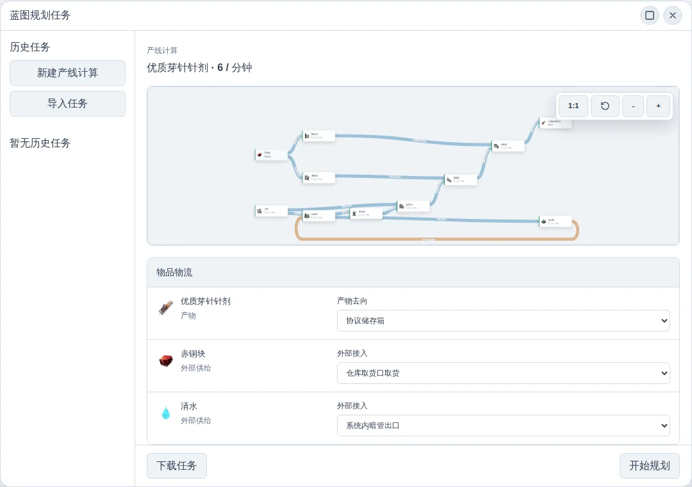
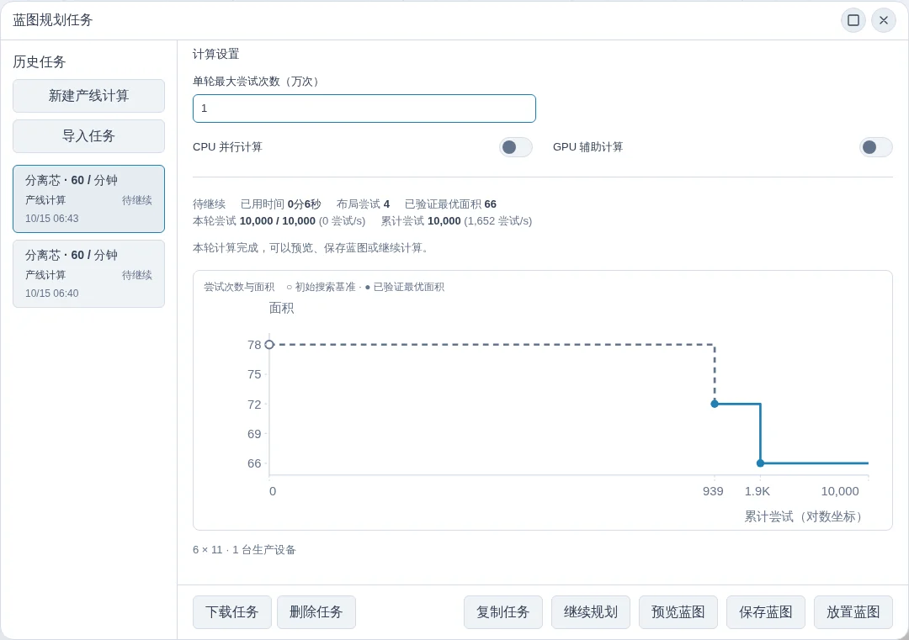
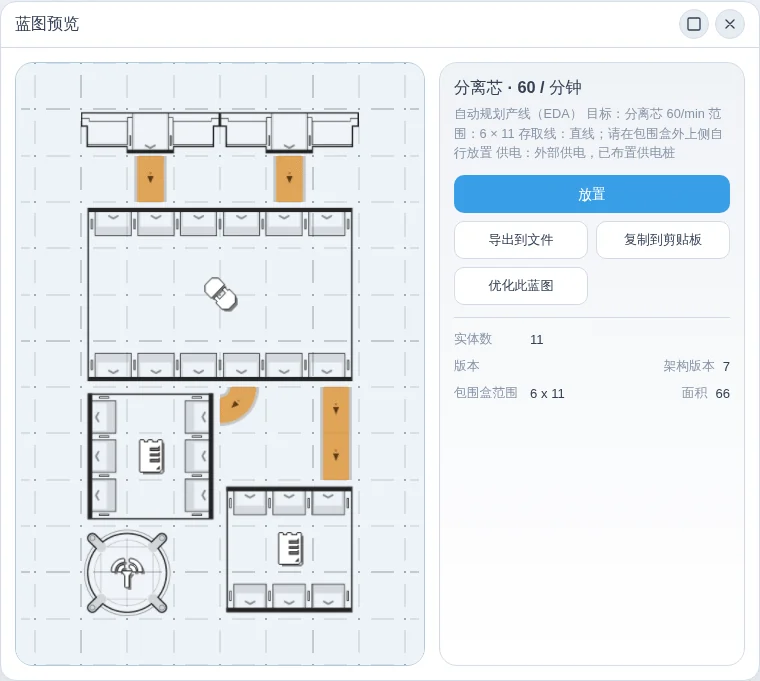
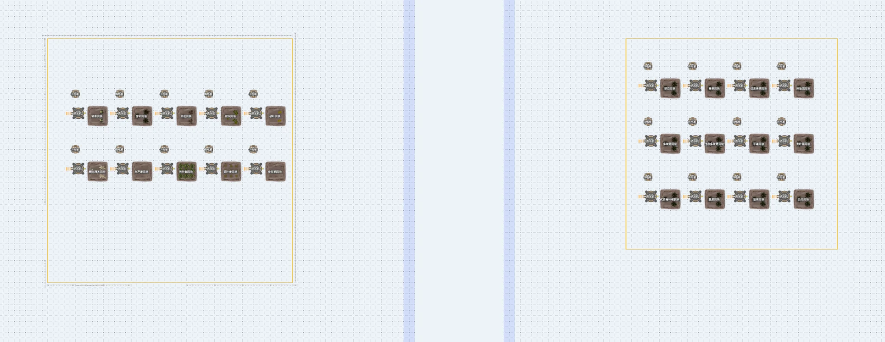
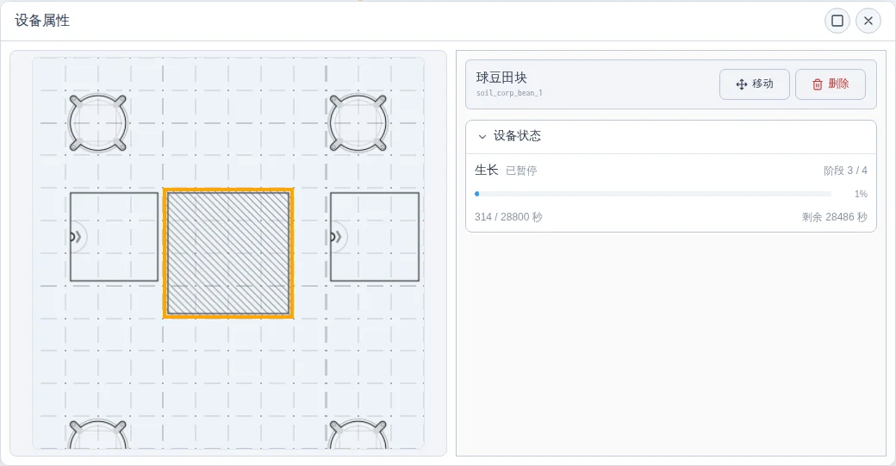

# 【浏览器里的集成工业】版本更新 v1.6.0

大家好！上个版本，我们带来了创造模式。这一次，除了自己动手搭建产线，也可以让规划器帮你安排设备和走线了！

本次更新带来全新的自动规划产线功能，同时新增农牧用地地图、二十二种田块与洒水机，并补齐缘缘庄的食材加工配方。

## 自动规划产线

想生产什么、每分钟需要多少？在工具箱的产线规划中设定目标，确认配方与原料来源，点击“自动规划该产线”，就可以自动安排设备位置和物流线路，生成经过仿真验证的蓝图。

> 图：以每分钟生产 6 个优质芽针针剂为目标，确认原料接入方式与成品去向后开始规划。

你可以调整原料接入、成品去向、环境供料和启动方式，让生成的蓝图适合自己的基地。计算任务支持暂停、继续和导入导出，也可以通过面积变化曲线观察优化成果。

> 图：以分离芯产线为例，面积曲线记录了从 78 格搜索基准到 66 格已验证布局的变化；本轮结束后可以继续计算或保存结果。

找到合适的结果后，可以保存并放置蓝图，按所选供料方式补齐外部连接，再启动仿真。更紧凑的布局需要持续搜索，增加尝试次数也不保证每轮都能找到更小的结果。

> 图：预览每分钟生产 60 个分离芯的规划结果，检查设备与物流布局，再保存为可放置的蓝图。

## 农牧用地与田块

新增“农牧用地”地图，包含武陵农用地与缘缘庄两个区域，并完善区域边界与布局，方便提前安排农业布局。

> 图：在同一张农牧用地地图中安排两个区域的田块与洒水机，武陵农用地同时补上围栏和立柱。

新增“农业建筑”分类，提供二十二种田块与洒水机，支持在农牧用地摆放，并查看洒水机的浇灌覆盖范围。

在原有十种田块之外，缘缘庄新增球豆、青菜、籽油花、多味菇、平薯、青叶莓、脆蔗、茄果、白瓜九类食材田块，以及优质青菜、优质多味菇、优质青叶莓三种优质田块。这十二种新田块仅能摆放在缘缘庄区域。

田块现在会依次经历育苗、浇水、生长与收获，外观随阶段变化；选中田块，可以查看当前阶段、进度和剩余时间。洒水机会按覆盖范围内田块的需水情况运行，并显示浇灌动画；断水时保留已经完成的浇水进度，恢复供水后继续。

> 图：选中正在生长的田块，查看当前阶段、已用时间和剩余时间，方便检查灌溉与种植进度。

成熟后的基础收获会直接进入仓库，并开始下一轮种植；球豆、平薯保留副产物，优质田块同时产出普通与优质作物。优质田块作为独立田块模拟，不包含随机变异和施肥增产。原有灰芦麦、苦叶椒、琼叶参、金石稻田块的基础收获量也同步调整为每轮 30 个。

### 食材加工与配平

新增 38 种相关物品和 25 条加工配方，覆盖采种、食材加工、副产物加工、饲料与瓶装饮品，可用于百科查询、产线规划、模块配平和基地仿真。面粉、菜籽油、辣椒粉、淀粉、砂糖等食材加工，也可以接入现有生产设备。

> 图：在百科中查看新增食材的原料、加工设备与产出，继续规划收获后的加工产线。

模块配平新增“武陵1.6版本资源”预设，方便按新版本的资源条件安排生产。

## 其他改动

- 产线规划支持将自然资源设为无限供给，切换后按外部供给计算；取消无限供给时恢复此前填写的有限数量。
- 新增货物进入设备的动画，让传送带上的货物在成功交接后继续移动进入设备，暂停与回放跳转时同步调整显示。
- 新增蓝图只读嵌入模式，可在其他网页展示蓝图和运行仿真。
- 新增设备断电标识，帮助发现未被供电范围覆盖的设备，放置和移动时也可查看。
- 草稿箱支持自由放置、复制和删除协议核心。
- 新增反转滚轮缩放设置。
- 修复采种与种植循环产线的供需及设备数量计算。
- 修复已下载的离线动画与音频包在刷新后重复出现下载提示的问题。
- 蓝图预览新增占地面积显示，便于比较布局大小。
