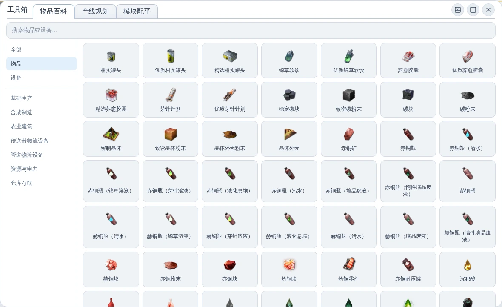
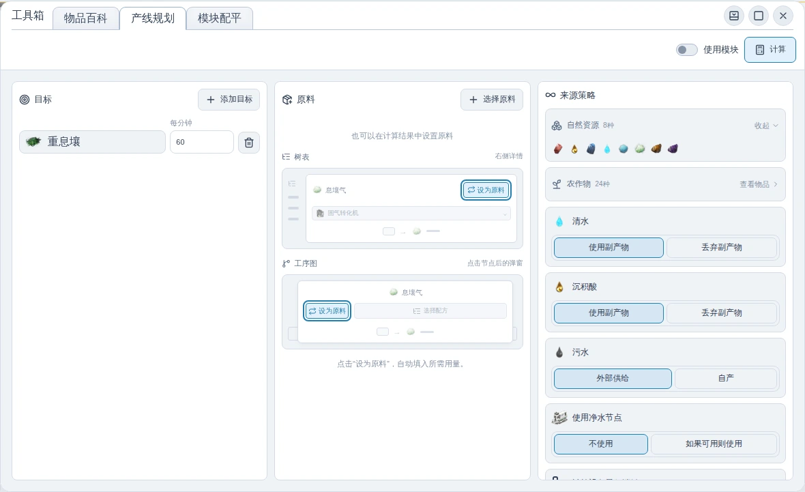
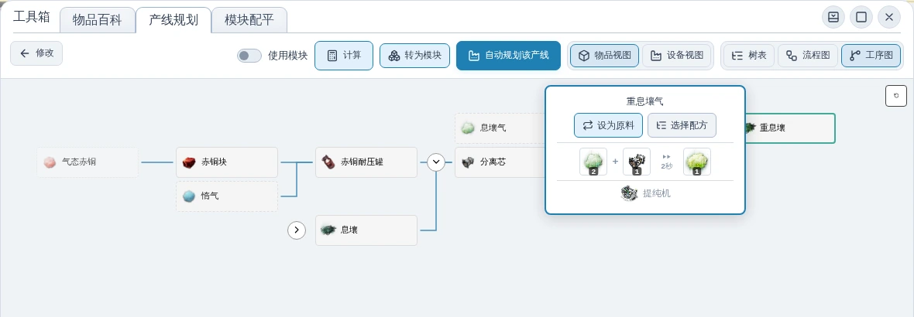

# 【浏览器里的集成工业】版本更新 v1.6.1

## 高清化

- 替换所有物品图标为高清图片（再次感谢 [AKEData](https://www.akedata.wiki/)）。

> 图：在物品百科中浏览更新后的高清图标，查看物品的外观与细节。

## 产线规划体验优化

### 更集中的操作入口

- 将“使用模块”开关与“计算”按钮移至顶部，输入页和结果页共用工具栏，修改条件后可以直接重新计算。
- 重新整理目标、原料与来源策略三栏，各栏独立滚动，方便查看较长的设置内容。
- 自然资源与农作物分类默认收起，显示物品数量，需要时再展开查看；原料区域新增操作图示，帮助找到计算结果中的“设为原料”入口。

> 图：以每分钟生产 60 个重息壤为目标，在同一界面中设置目标产量、原料与来源策略。

### 在工序图中直接调整产线

- 计算后默认打开工序图，主链保持展开，支线按需展开；相同物品出现在不同支线时，可以分别展开或收起。
- 点击物品节点，即可选择配方、设为原料或移除外部供给。“设为原料”会自动填入满足当前需求的用量，并同步更新计算结果。
- 展开、收起支线或调整原料时，保持当前节点的位置，减少视野跳动。
- 修复工序图首列图标被裁切、详情弹窗超出画布的问题，并补充节点与展开按钮的键盘操作支持。

> 图：展开上游支线后，点击物品节点即可设置原料或选择配方，继续调整产线。

## 其他更新

- 修复了自动规划功能的诸多问题
- 增加了自动农植机
