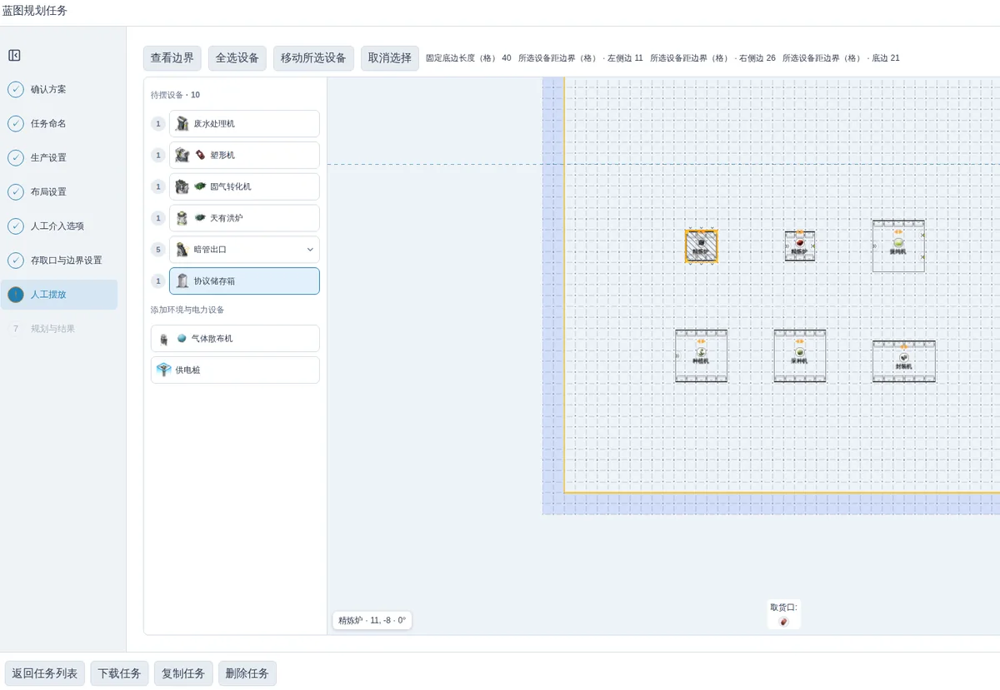
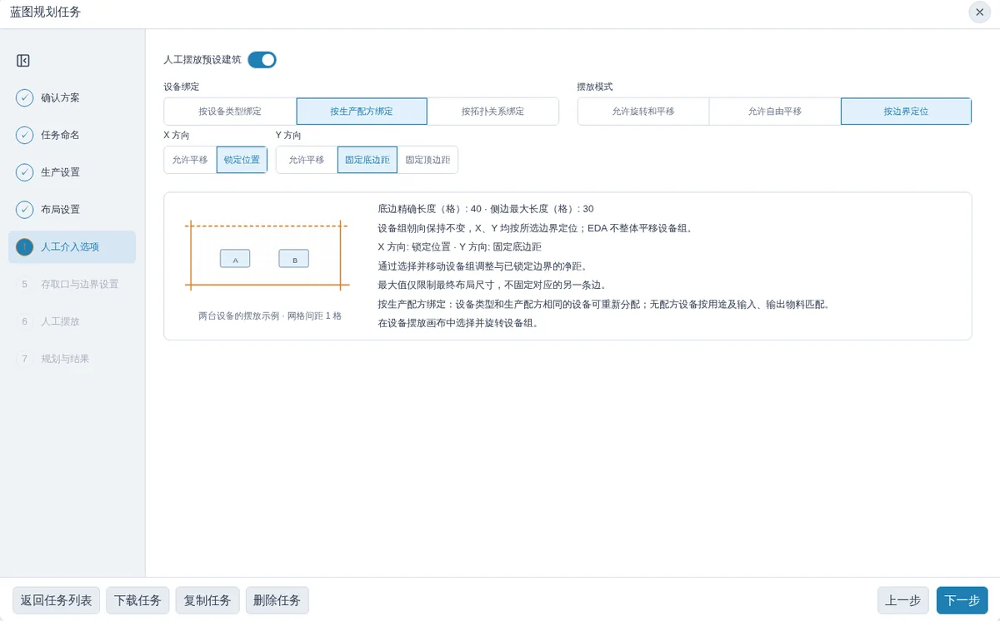
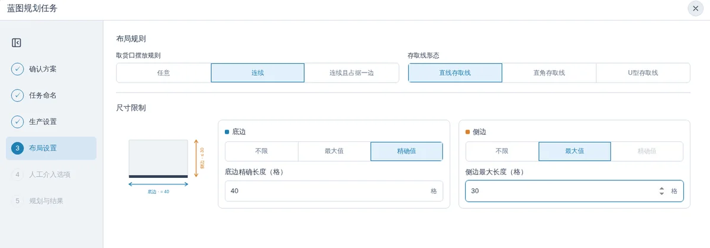

# 【浏览器里的集成工业】版本更新 v1.7.0

大家好！上一版我们把自动规划产线交给了规划器。这一次，我们进一步增加了可调节的选项，现在你可以先按自己的思路把部分设备摆好，再让规划器补齐物流、收紧尺寸，得到的蓝图会更贴合基地里真正空出来的那块地。

(新版本因为支持了更多复杂的计算模式，算法运行速度略微下降，后续会继续优化迭代算法速度)

## 1.7 版本新设备

本版同步跟进游戏 1.7 版本的新设备、新物品与新配方，它们和原有内容一样可以查询、摆放，并参与产线规划、模块配平与仿真。

> 图：新增设备的图标，以及部分新物品与典型配方。

明晦炉与分影明晦炉已经接入：消耗息壤气，在离体区域提供明、晦或衡效果，分影明晦炉同时覆盖两个区域。多个炉子的区域会合并叠加，区域每累计运行 10 秒，按当时的层数概率转化范围内的传送带物品；检查器里可以为炉子选择明或晦。区域内放了不能进入的设备，或两个作用区域部分重叠时，相关炉子会标为无效布局。

目前设备的外观使用占位符，是因为素材还在处理中，稍后处理完毕会再次更新。

其中明晦炉的机制为：区域每10秒进行一次判断，对区域内传送带上所有满足条件的物品应用概率转化。转化概率根据判断瞬间正在工作的炉子决定。如果所有区域炉子都停工，则计时暂停。

## 人工摆放

产线规划换成了分步向导：确认方案、任务命名、生产设置、布局设置、人工介入选项、存取口与边界设置、人工摆放、规划与结果。规划窗口现在是铺开的工作区，步骤可以随时点开切换；改动前序设置后，受影响的步骤会标出来提醒复核。

打开“人工摆放预设建筑”后，就能在画布上先摆设备：从设备列表拖入或点选放置，选中后移动、旋转、整组移动，也可以框选多个设备、全选或取消选择。列表会把同类设备合并显示数量，非按设备类型绑定时还会标出对应的物品；环境与电力设备可以按需额外添加。

> 图：先手动摆好设备，选中后可在顶部看到它到各条已锁定边界的净距。

规划器会保留你摆出的相对位置，只负责补线。设备之间按什么规则算作“同一台”，可以按设备类型、生产配方或拓扑关系绑定：类型相同即可互换；配方相同即可互换，没有配方的设备按用途和输入输出物料匹配；拓扑关系则固定预摆位置对应的生产节点和连接。

### 摆放方式

- **允许旋转和平移**：保留设备组内部的相对关系，规划时可以整体旋转，也可以沿两个方向平移。
- **允许自由平移**：保持你摆的朝向，只沿两个方向平移。
- **按边界定位**：让设备组贴着指定的边摆放。X、Y 两个方向可以分别选择允许平移、锁定位置，或固定左边距、右边距、底边距、顶边距。

选择固定朝向的摆放方式后，画布会用参考线标出尺寸边界；按边界定位时还会显示已锁定的边。选中设备就能看到它到各条边界的净距，直接移动设备即可调整，不需要手动填写坐标。

> 图：选择设备绑定方式与摆放模式，右侧预览会说明规划器可以如何移动这组设备。

### 存取口与边界设置

这一步决定存取线实际位于设备组的哪一边：直线存取线可选上、右、下、左；直角存取线分别选择横段和支段所在的边；U 型存取线选择横段在顶边还是底边。切换后，物品会跟着所属线段换边，示意图和最终蓝图使用同一组边。分配好物品的取货口会在画布内侧以物品图标标出，平移、缩放时都保持可见。

## 尺寸与终止条件

布局设置新增了底边和侧边各自的长度限制：不限、最大值或精确值，两个方向最多只有一个能填精确值。示意图会直接标出当前限制，规则冲突时会说明原因；由“固定双侧”推出的底边长度也可以一键解除。

> 图：分别为底边与侧边设置精确值或最大值，左侧示意图会同步标出当前限制。

计算设置新增“面积达标即停止”：填好目标面积后，规划器一旦拿到通过验收、且面积严格小于该值的蓝图就会结束计算，不必一直等下去。

> 图：填写目标面积后，找到合格且面积更小的蓝图就会结束本轮计算。

## 规划质量

- 蓝图在交付前会再做一次物流整理：绕远的路段尽量取短，必要时调整仓库取货口的物品顺序，减少多余的桥接器；整理后仍要通过施工与产量验证，不达标的方案不会交付。
- 反应池和扩容反应池现在可以借道：上游物料能穿过正在生产的池体送到下游，省下绕过池体的管路和传送带空间。
- “固体循环启动处理”选择设备内预置启动物品时，会按设备实际容量装满作物槽和种子槽。

## 其他改动

- 修复产线规划中瓶装兽奶、瓶装优质兽奶找不到装瓶配方的问题；兽奶与优质兽奶需要作为原料接入，不会被当成无限供给。
- 规划结果页的蓝图预览改为自动适配，打开就能看全整个蓝图。
- 基地边界线改为按实际区域外缘绘制，相互衔接的分区之间不再多出一条边线。
- 窄屏下底栏的站点声明改为点按展开的浮层，不再挤压状态栏里的其它信息。
- 底栏新增当前访问站点标识，方便确认自己正在使用哪个站点。
- 升级后，旧版本创建的规划任务可以继续计算，已有的计算进度和通过验收的结果都会保留。
